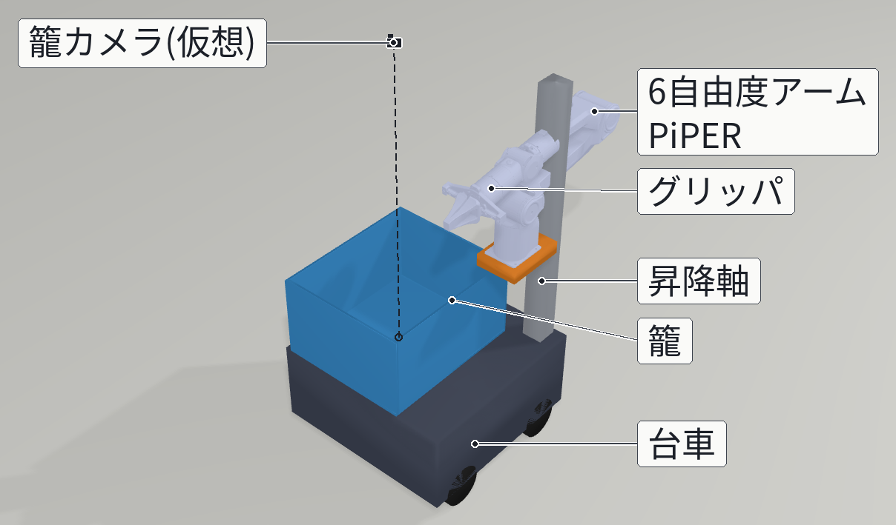

# 洗濯物を洗濯機へ運ぶロボット: 1K 住居モデルにおける VLM 知覚と布の摩擦把持のシミュレーション

AI×ロボティクスによる創造的タスクの実現 最終レポート

## 1. 概要と目的

家事の中でも「部屋で取り込んだ洗濯物を洗濯機まで運び、槽に入れる」作業は、運ぶ・探す・つまむ・入れるという異なる能力を一続きに要求する。本課題では、この作業をシミュレーション上のロボットに行わせた。ロボットは、洋室で籠に入れた洗濯物を廊下を通って縦型洗濯機の前まで運び、籠の中から 1 着ずつつまんで槽へ投入する。映像・結果はすべてシミュレーションである。

この作業が難しい理由は 3 つある。布は変形体で、形が毎回変わり、つまむ位置が少しずれると持ち上げや運搬で抜け落ちる。洗濯物は小さく、重なって隠れる。廊下は幅 0.6 m<!-- src: report_detail.md 第 1 章 tools/params.py CORRIDOR_X --> と狭く、廊下の中では旋回できない。

見せるものは、タオル・T シャツ・靴下の 3 着<!-- src: report_detail.md 第 4.2 章 --> を、観測と把持を繰り返して全部投入する場面である。AI 要素は自前のマシンで動かす視覚言語モデル（VLM）で、籠を真上から写すカメラ画像から洗濯物を見つける。

## 2. システム

舞台は 1K の住居モデルである。大まかな推定寸法だけで箱を組み合わせ、テクスチャは手続き生成した。ロボットは、ホロノミック台車、昇降軸、6 軸アーム PiPER、籠、籠の真上に固定した RGB-D カメラからなる（図2）。台車は仮想関節で動かし、車輪の物理は再現していない。

物理は Genesis 1.4.4<!-- src: report_detail.md 2.2 節 --> に、IPC（Incremental Potential Contact）の実装 libuipc を連成して解いた。最初に試した Genesis の位置ベース（PBD）の布は、剛体との接触に摩擦がなく、指で挟んでも布の上昇は 0.000 m<!-- src: report_detail.md 2.2 節 --> だった。この場合は把持中だけ布を指に固定する近似が必要になり、「つまめるか」自体が検証できない。IPC の有限要素布なら、接触と摩擦だけで布を挟んで持ち上げられる。

シミュレーションのロボットを実際に組むとしたときの、仕様が近い市販品の例と参考価格を表1に示す。

| 部品 | 製品の例 | 参考価格 |
| ---- | -------- | -------- |
| 台車（メカナム 4 輪、41 cm 角、積載 15 kg） | Wheeltec R5 Series | $454.95 |
| 昇降軸（電動コラム、ストローク 648 mm） | Progressive Automations LG-02 | $115.99 |
| 6 自由度アーム | AgileX PiPER | $1,999.00 |
| RGB-D カメラ | RealSense D435i | $399.00 |
| 合計 | | 約 $2,969（約 47 万円） |

<!-- src: README.md「ロボットの部品と参考価格」、docs/final_video/parts_ja.json parts[].price_usd / label。合計・円換算は README の表の値。 -->

表1: 組むとした場合の部品と参考価格（2026-10-30 の販売ページの表示価格、1 ドル = 157.54 円<!-- src: docs/final_video/parts_ja.json usd_jpy -->）。グリッパ・駆動回路・電池・昇降の制御箱・VLM を動かす計算機は含まない。実機は作っていない。

## 3. 工夫した点

### (a) 布を接触と摩擦だけでつかむ

指に布を固定せず、IPC の接触と摩擦だけで挟んで持ち上げる。当初は 40 N<!-- src: report_detail.md 2.2 節 --> で挟んでも布がじわじわ滑り落ちた。原因は Newton 反復の収束許容値で、ライブラリ既定の 0.05 m/s<!-- src: report_detail.md 2.2 節 --> では摩擦が解けきる前にソルバが止まる。許容値を 1e-3 m/s<!-- src: report_detail.md 2.2 節 --> にして摩擦把持が成り立った。

### (b) 走行中に布が籠の中でずれない

走行ありの統合テイクで、籠の中の布が走行中に後ろの壁まで滑り、持ち上げで抜ける失敗が多かった。原因は、libuipc が既定で有効にしている Newton 反復の semi-implicit 早期終了だった。1.2 m 直進する試験で、既定のままだと走り出し 1 s で布が -94.7 mm<!-- src: report_detail.md 2.3 節 --> ずれたが、早期終了を切ると 0.0〜0.1 mm<!-- src: report_detail.md 2.3 節 --> になった。代償は計算時間である（第 4 章）。

### (c) 画像と点群からつかむ物と点を決める

どれを・どこで・どの向きでつかむかは、カメラ画像と点群から決める。1 サイクルの流れは次のとおりである。

1. VLM が洗濯物ごとに bbox とラベルを返す。
2. 籠の青色との色差と点群で、bbox ごとに布のマスクを切り出す。
3. どの検出にも入らない布色の領域があれば、VLM に聞き直す（recheck）。
4. 見えている表面が最も高い検出から順に選ぶ。
5. マスク内の点群から把持点と、グリッパのヨーを決める（下記）。

把持点は次のように決める。マスクの縁は下の衣類の点が混ざるので、2 px 内側に削ってから点群を取る<!-- src: scripts/multi_integrated_demo.py --erode default 2 -->。検出の重心を中心に半径 5 cm<!-- src: scripts/cloth_ipc_washer_test.py --grasp-r default 0.05 --> 以内（籠の壁から 5 cm の帯は除く<!-- src: scripts/cloth_ipc_washer_test.py select_grasp inner -->）で最も高い点を選び、指先をその 3 cm<!-- src: README.md BASE --depth 0.03 --> 下まで下ろす。最も高い点が籠の底から 3 cm<!-- src: README.md BASE --floor-clear 0.015 + --min-bite 0.015 --> に満たないときは、半径を 2 cm<!-- src: scripts/cloth_ipc_washer_test.py select_grasp r += 0.02 --> ずつ広げる。平らな布に指を下ろすと指先が籠の底に当たり、薄い縁しか挟めないためである。ヨーは、その点の周り（半径 4 cm、3 cm 下まで<!-- src: scripts/cloth_ipc_washer_test.py ridge_yaws -->）の点の主成分分析で布のしわの向きを求め、指がしわを横切って閉じる向きから 15° 刻みで試し、近づく動きと下ろす動きが干渉なしで計画できた最初の向きを使う<!-- src: scripts/cloth_ipc_washer_test.py yaw_candidates / approach_planned -->。空振りしたら、試した点から 4 cm<!-- src: scripts/cloth_ipc_washer_test.py --exclude-r default 0.04 --> 以上離れた点でやり直す。

VLM が行うのは検出とラベル付けだけで、順番と把持点は点群から決めており、VLM は決めていない。ラベルは、サイクルをまたいで同じ衣類を追跡するためにだけ使う。

### (d) 失敗からの回復

毎サイクル籠を観測し直すので、籠に戻った衣類は後のサイクルで拾える。把持の成否は、シミュレータの接触数と挟む力（全衣類の合計）を模擬した触覚・力覚で判定し、空振りなら別の点でやり直す。指を開いた後も布が指に残るときは、手首を振って振り落とす。

## 4. 結果

3 着のテイクを 12 本<!-- src: report_detail.md 4.2 節 --> 実行した（同じコード・同じ設定、シードのみ変更）。36 着中 32 着<!-- src: report_detail.md 4.2 節 --> を槽に投入し、3 着全部が入ったのは 12 本中 8 本<!-- src: report_detail.md 4.2 節 --> だった。把持の試行は合計 29 回<!-- src: report_detail.md 4.2 節 -->（1 本あたり 1〜4 回<!-- src: report_detail.md 4.2 節の表 -->）で、うち 11 回<!-- src: report_detail.md 4.2 節 --> は 2 着以上を同時に持ち上げた。

入らなかった 4 着<!-- src: report_detail.md 4.2 節 --> は、すべて運搬中に籠の外へ落ちた。3 着は 2 着以上を同時に持ち上げた後で、1 着は 1 着だけの運搬中だった<!-- src: report_detail.md 第 5 章 -->。床に落ちた物を拾う動作は実装していない。VLM のラベルが合ったのは 45 件中 23 件<!-- src: report_detail.md 第 5 章 -->で、順番をラベルではなく表面の高さで決めているのはこのためである。

計算コストは大きい。1 テイクの実時間は約 62〜115 分<!-- src: report_detail.md 第 6 章 -->で、シミュレーション時間の約 46〜79 倍<!-- src: report_detail.md 第 6 章 -->かかった。VRAM は 4.5〜7.7 GB<!-- src: report_detail.md 第 6 章 -->である。

提出動画は、このうち 1 本（R3 s1<!-- src: report_detail.md 4.2 節の表 -->）をシミュレーション時間の等倍で撮ったものである。VLM の推論中はシミュレーションを止め、検出結果のカードを静止表示している。

## 5. 限界と開示

- **シミュレーションのみ。** 実機では試していない。台車は仮想関節で動かしており、車輪と床の物理はない。
- **住居の寸法は大まかな推定値。** 1K の住居モデルは箱の組み合わせで、テクスチャは手続き生成である。
- **衣類は 1 層の平らなメッシュで、曲げ剛性を持たない。** 大きさも籠に合わせて縮めており、実物と比が違う。各衣類は 1 色で、柄はない。
- **色に頼った切り分け。** 同じ色の衣類が 2 着あると、bbox の位置だけで分けることになる。柄物は試していない。
- **知覚と真値の境界。** 把持の対象・点・向き・終了の判断は、カメラ画像と点群（と VLM）による。一方、槽に入ったかの採点と動画の「シミュレーション判定」の表示は真値による。触覚・力覚は、シミュレータの接触数と力を模擬したものである。
- **試行数が少ない。** 12 本で、IPC の結果は同じシードでも実行ごとに変わる。成功率は目安にとどまる。
- **籠カメラは仮想。** 籠の中心の真上、床から 1.0 m<!-- src: tools/params.py BASKET_CAM_POS（台車の座標、原点は床） --> に真下向きで置いた形のないカメラで、腕と干渉しない。実機では、昇降軸の上端から張り出した支柱に付ける（支柱を経路計画の障害物に入れる）か、手首のカメラで観測のたびに腕を籠の上へ動かす（その分の時間がかかる）。どちらでも腕が視界を遮らない姿勢で撮る必要がある（本シミュレーションも腕を待機姿勢に戻して観測している）。布の上での深度の欠けや、照明による色の変化は試していない。
- **動画の時間。** 動画は等倍に見えるが、計算は実時間の数十倍かかっており、その速さで動いたわけではない。
- 数値の出典・失敗の分析・計算コストなどの詳細は、リポジトリの `docs/report/report_detail.md` にまとめた。

## 6. 今後の課題

- **ナビゲーションとの統合。** 台車は決めた経路点を仮想関節でたどっている。自己位置推定・経路計画と車輪の物理を入れる。
- **床からの拾い上げと掴み直し。** 入らなかった衣類はすべて籠の外に落ちた。床の衣類を見つけて拾う動作と、2 着同時に持ち上げたときの掴み直しで、この失敗から回復できる。
- **ドア開けなど他の動作との組み合わせ。** 今回は扉もふたも開いた状態から始めている。
- **物理的にリアルな衣類。** 2 層の構造、曲げ剛性、厚み、実物の大きさと重さを入れる。
- **見た目もリアルにした VLM の検証。** 柄・質感・照明を実物に近づけ、種類の判定（今回は 45 件中 23 件）や見落としを、実写の画像も含めて調べる。

使用したソフトウェアとモデル: Genesis 1.4.4、libuipc（IPC: Li ら, ACM TOG 39(4), 2020）、PiPER の公式モデル（MIT ライセンス）、Qwen3-VL 8B（ollama の `qwen3-vl:8b-instruct`）。URL は詳細版の参考に記載した。

---

## 付録 A: 図の一覧（作成元）

| 図 | ファイル | 作成元 |
| -- | -------- | ------ |
| 図1 | figures/fig01_pipeline.png | `docs/report/make_images.py` で描いたブロック図。走行・静置、1 サイクルの 6 段階（第 3 章 (c)）、終了。使う情報（知覚・模擬した触覚と力覚・真値）で色分け |
| 図2 | figures/fig10_robot_setup.png | outputs/robot_view_labeled_crop.png（`scripts/render_robot.py` の部品名付きのロボットの描画の切り抜き。`make_images.py` で複製） |
| 図3 | figures/fig05_multi_card.png | outputs/multi/r3_s0_card_c1.png（R3 s0 の 1 回目の観測カード） |
| 図4 | figures/fig07_multi_cycles.png | 12 テイクの JSON の cycles[].n_in_tub_after と objects_final[].where（`make_charts.py`。合計 32/36 を確認） |
