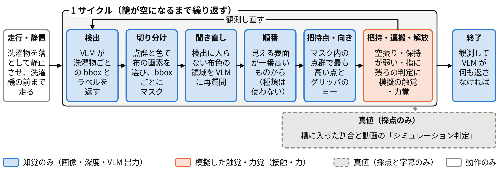
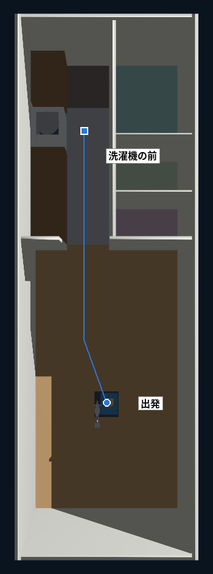
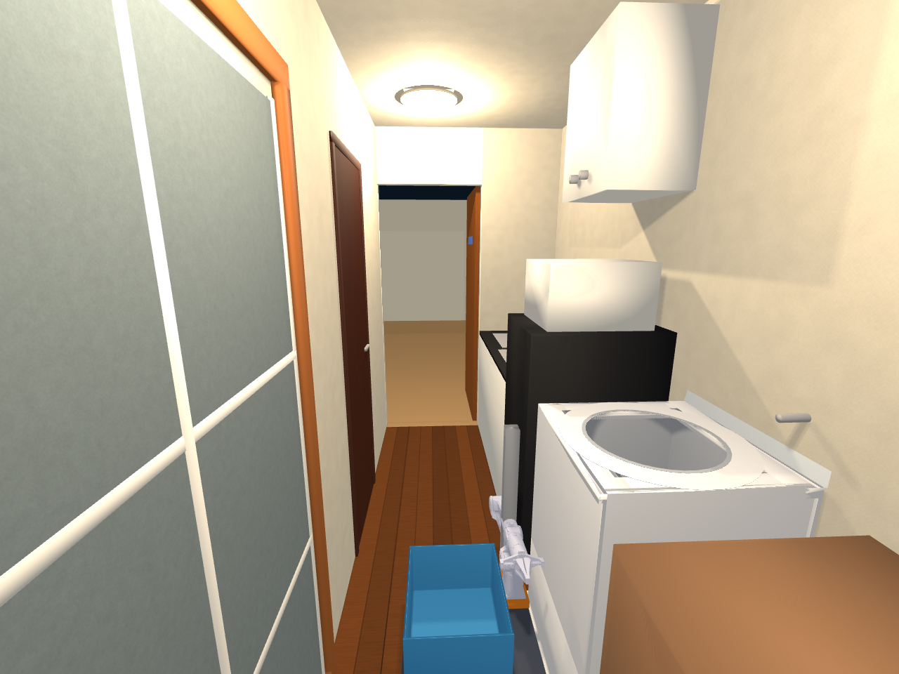
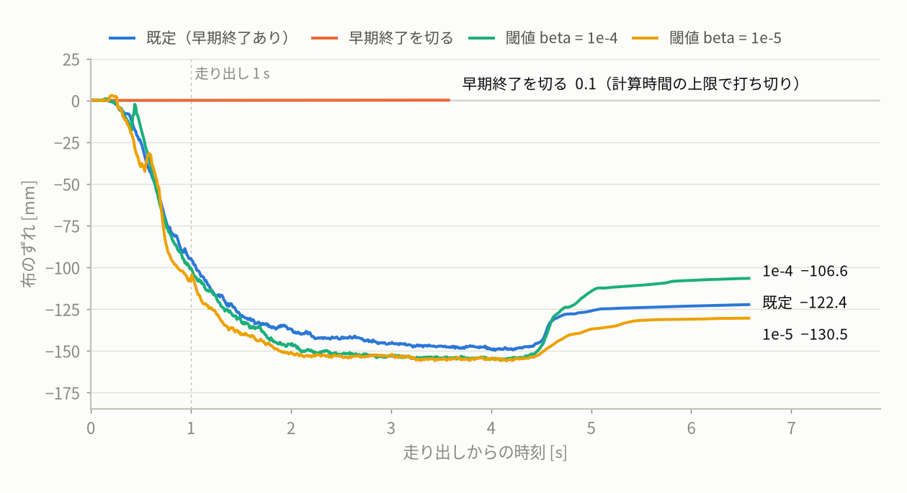
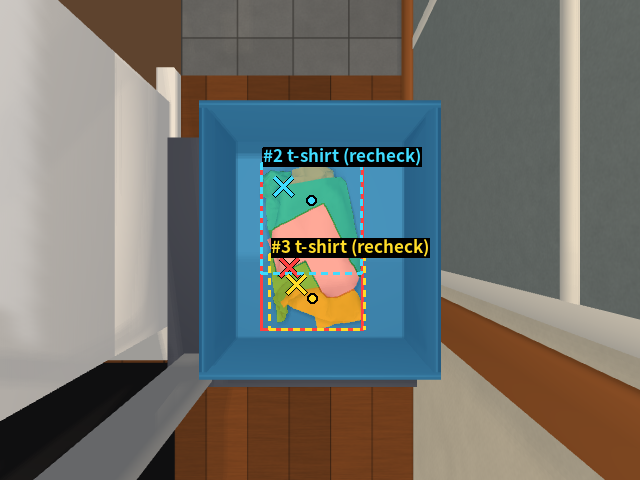
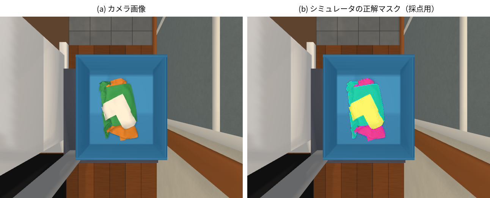
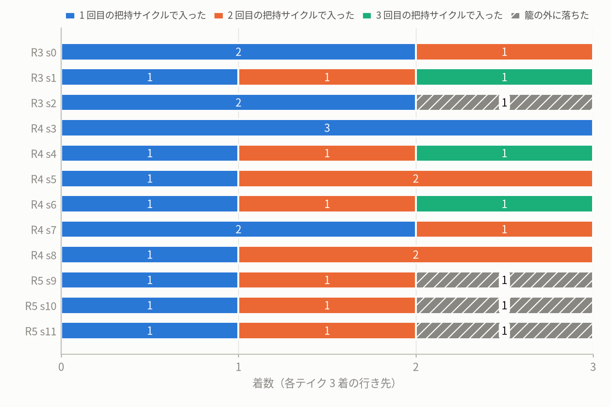
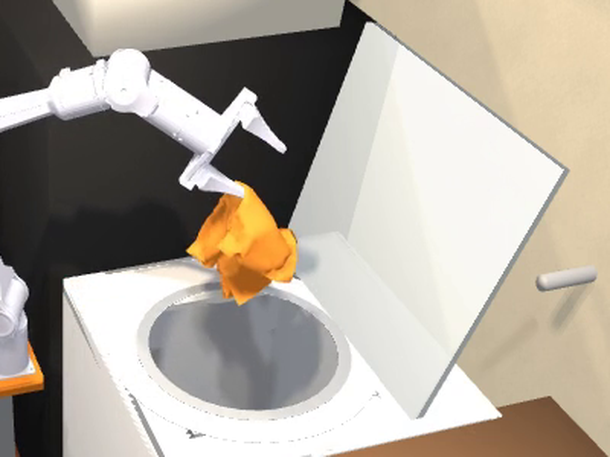
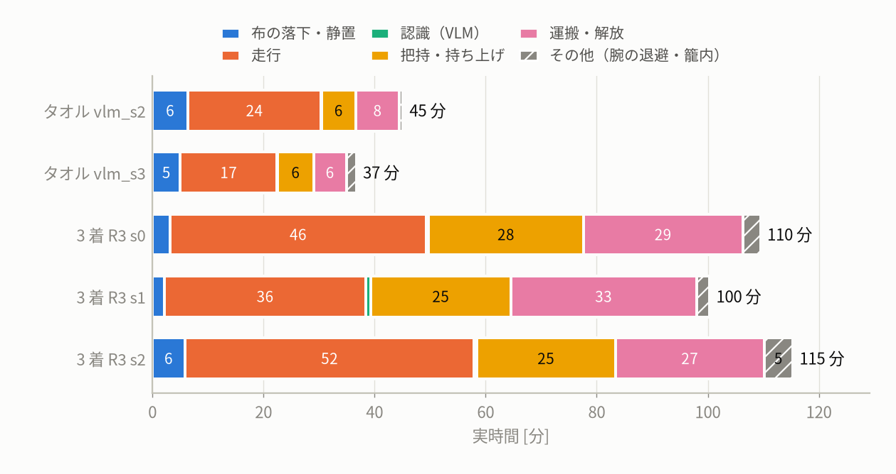

# 洗濯物を洗濯機へ運ぶロボット: 1K 住居モデルにおける VLM 知覚と布の摩擦把持のシミュレーション

AI×ロボティクスによる創造的タスクの実現 最終レポート 詳細版（補足資料）

<!-- 草稿の約束: 数値の直後の HTML コメントに出典（リポジトリまたは outputs/ のファイルとフィールド）を書く。
     outputs/ は gitignore 済みで公開リポジトリには含まれない。docs/knowledge/ は作業メモ（公開対象外）。
     表の数値は表の直後のコメントに列ごとの出典をまとめて書く。 -->

## 1. 目的と課題設定

家事の中でも「部屋で取り込んだ洗濯物を洗濯機まで運び、槽に入れる」作業は、運ぶ・探す・つまむ・入れるという異なる能力を一続きに要求する。本課題では、この作業をシミュレーション上のロボットに行わせた。舞台は 1K の住居モデルで、洋室で籠に入れた洗濯物を、ホロノミック台車・昇降軸・6 軸アーム PiPER・籠を備えたロボットが廊下を通って縦型洗濯機の前まで運び、籠の中から 1 着ずつつまんで槽へ投入する。AI 要素は自前のマシンで動かす視覚言語モデル（VLM）で、籠を真上から写すカメラ画像から洗濯物を見つける。

シナリオは 2 つ用意した。(A) タオル 1 枚を運んで投入する統合テイクと、(B) タオル・T シャツ・靴下の 3 着を、観測と把持を繰り返して全部投入するテイクである。(B) では、どれを・どこで・どの向きでつかむかを、カメラ画像と点群だけから決める。

この作業が難しい理由は 3 つある。

1. **布は変形体である。** 形が毎回変わり、同じシードでも山の形や高さが実行ごとに変わる。つまむ位置が少しずれると、持ち上げで指から抜ける、運搬中に落ちる、指を開いても指に残る、といった失敗が起きる。剛体の「把持姿勢」のように一度決めれば済むものがない。
2. **対象が小さく、重なっている。** 靴下は幅 0.07 m<!-- src: scripts/garments.py docstring (sock leg 0.07 x 0.15 m) --> で、T シャツの上や下に隠れる。PiPER のグリッパの開口は約 7 cm<!-- src: docs/knowledge/debugging.md「把持は weld 拘束で近似している」 --> で、籠の内寸は 0.35 × 0.30 × 0.20 m<!-- src: tools/params.py BASKET_INNER --> と狭い。
3. **住居が狭い。** 廊下は幅 0.6 m<!-- src: tools/params.py CORRIDOR_X (0.6, 1.2) --> で、冷蔵庫の前では 0.575 m<!-- src: tools/params.py CORRIDOR_X[1] - FRIDGE_X[1] = 1.2 - 0.625 --> しかない。腕を含めた台車の幅は 0.467 m<!-- src: docs/knowledge/architecture.md「シーン構成と座標系」 --> なので、両側の余裕は約 5 cm<!-- src: docs/knowledge/architecture.md「シーン構成と座標系」 --> で、廊下の中では旋回できない。洗濯機の上面は高さ 0.90 m<!-- src: tools/params.py WASHER_H --> で、真下向きのグリッパでは手先が約 0.90 m<!-- src: docs/knowledge/debugging.md「経路計画（Genesis の plan_path）で守ること」 --> までしか上がらないため、手首を傾けて運ぶ必要がある。

## 2. システム構成

### 2.1 シーンとロボット

住居は幅 2.7 m<!-- src: tools/params.py ROOM_W -->・奥行 8.4 m<!-- src: tools/params.py UPPER_Y[1] --> の 1K を、大まかな推定寸法だけで箱の組み合わせとしてモデル化した（寸法はすべて `tools/params.py`）。洋室（奥行 0–4.9 m<!-- src: tools/params.py MAIN_Y -->）から間仕切りの開口を抜け、廊下の奥の洗濯機まで走る。衝突判定は箱のまま、見た目は箱の手前に面を重ねて表現し、テクスチャは写真ではなく手続き生成したものを使った。走行経路は長さ 5.238 m<!-- src: outputs/multi/r3_s0.json drive.length_m -->、速度 0.3 m/s<!-- src: outputs/multi/r3_s0.json drive.speed_m_s -->、所要 18.06 s<!-- src: outputs/multi/r3_s0.json drive.duration_s --> である。

ロボットは 0.45 m 角<!-- src: tools/params.py BASE_SIZE --> の台車、0–0.5 m<!-- src: tools/params.py LIFT_RANGE --> の昇降軸、PiPER（6 軸＋平行グリッパ）、籠からなる。台車は x・y・ヨーの仮想関節で動かし、メカナムホイールの物理は再現していない。籠の中心の真上、床から 1.0 m<!-- src: tools/params.py BASKET_CAM_POS（台車の座標、原点は床） --> に、640 × 480 px<!-- src: tools/params.py BASKET_CAM_RES -->・垂直画角 60°<!-- src: tools/params.py BASKET_CAM_FOV --> の RGB-D カメラを台車に固定している。

### 2.2 シミュレータ: なぜ IPC か

物理は Genesis 1.4.4<!-- src: requirements-ipc.txt genesis-world==1.4.4 --> に、IPC（Incremental Potential Contact）の実装である libuipc（pyuipc 0.0.28<!-- src: requirements-ipc.txt pyuipc==0.0.28 -->）を連成して解いた。最初に試した Genesis の位置ベース（PBD）の布は、剛体との接触に摩擦がなく、指で挟んでも布の上昇は 0.000 m<!-- src: docs/knowledge/debugging.md「PBD 布は剛体との接触に摩擦がない」 --> だった。この場合、把持中だけ布の粒子を指に固定する近似が必要になり、「つまめるか」自体が検証できない。IPC の有限要素布（FEM.Cloth）なら、接触と摩擦だけで布を挟んで持ち上げられる。グリッパの 3 リンクと籠を IPC に入れ、洗濯機は固定物体として IPC 側だけに置いた。

主な設定は、時間刻み 0.01 s<!-- src: scripts/cloth_ipc_washer_test.py --dt default -->、把持力の上限 40 N<!-- src: README.md BASE --grip-fmax 40 -->（実機 PiPER グリッパの定格 40 N<!-- src: docs/knowledge/debugging.md「IPC の摩擦把持で布が滑り落ちる主因は Newton の収束許容値」 --> に合わせた）、摩擦係数 1.2<!-- src: README.md BASE --mu 1.2 -->、Newton の収束許容値 1e-3 m/s<!-- src: README.md BASE --newton-tol 1e-3 --> である。許容値がライブラリ既定の 0.05 m/s<!-- src: docs/knowledge/debugging.md「IPC の摩擦把持で布が滑り落ちる主因は Newton の収束許容値」 --> のままだと、摩擦が解けきる前にソルバが止まり、40 N で挟んでも布がじわじわ滑り落ちた。

衣類は、約 1 cm 格子の 1 層の平らなメッシュで近似した（実物の 2 層構造は扱わない）。タオルは 0.30 m 角<!-- src: scripts/garments.py docstring -->で 961 頂点<!-- src: outputs/multi/r3_s0.json objects[0].n_vertices -->、T シャツは 0.18 × 0.24 m の胴に袖を付けた全幅 0.32 m の T 字、靴下は 0.16 × 0.15 m の L 字<!-- src: scripts/garments.py docstring（靴下は脚 0.07 + 足先 0.09） --> で、3 着の合計は 1762 頂点<!-- src: outputs/multi/r3_s0.json n_vertices --> である。籠の内寸に収まるよう、T シャツは実物よりかなり小さくしてある。色は 1 着 1 色（タオルは橙、T シャツは緑、靴下は白<!-- src: scripts/garments.py COLORS -->）で、柄はない。

### 2.3 Newton の semi-implicit 早期終了を切る

走行ありの統合テイクでは、当初、籠の中の布が走行中に籠の後ろの壁まで滑って高く縮み、持ち上げで布が抜ける失敗が多かった。把持 18 回のうち布を保てたのは 7 回<!-- src: docs/knowledge/debugging.md「統合場面（走行あり）で掴み直しが増える理由」 --> だった。原因は、libuipc が既定で有効にしている Newton 反復の semi-implicit 早期終了だった（Genesis の説明文は既定を無効と書いているが、実際には有効である）。

1.2 m<!-- src: outputs/remote/drift_probe_base.json drift_probe.meta.drive_len --> 直進させる試験で、既定のままだと走り出し 1 s で布が −94.7 mm<!-- src: outputs/remote/drift_probe_base.json drift_probe.drift_dcx_mm["+1.0s"] --> ずれた。早期終了を切ると、ずれは 0.0〜0.1 mm<!-- src: outputs/remote/drift_probe_semi64.json drift_probe.drift_dcx_mm --> になった（この試験は計算時間の上限 300 s<!-- src: outputs/remote/drift_probe_semi64.json drift_probe.meta.aborted --> で走行の途中までの記録）。早期終了の閾値 beta を 1e-4・1e-5 に下げる案では −100.4 mm・−108.3 mm<!-- src: outputs/remote/drift_probe_beta1e-4.json / drift_probe_beta1e-5.json drift_probe.drift_dcx_mm["+1.0s"] --> で効かなかった。そこで提出用の設定は早期終了を切った（`--semi-implicit off`）。代償は計算時間で、第 6 章で述べる。

### 2.4 腕の経路計画

腕の動き（待機、降下、閉じ、持ち上げ、傾けながらの運搬、解放、待機への戻り、やり直し）は、IPC を含まない計画専用の Genesis シーンで区間ごとに計画した。まず関節空間の直線補間を試し、衝突するときだけ Genesis の RRTConnect を使う。得た経路は細かい刻みで検査し直し、腕と障害物の間に 10 mm<!-- src: scripts/cloth_ipc_washer_test.py docstring (margins 10 mm arm / 2 mm gripper-basket) -->、グリッパと籠の間に 2 mm<!-- src: scripts/cloth_ipc_washer_test.py docstring --> の余裕を要求する。計画は GPU バックエンドだと CPU より 25〜35 倍<!-- src: docs/knowledge/debugging.md「籠→槽の計画済み動作（TransferSeq）で分かった制約」 --> 遅かったため、CPU の子プロセスで行う。運搬は、真上に上げてから 6 個<!-- src: README.md BASE --n-wp 6 --> のウェイポイントで 12°<!-- src: scripts/cloth_ipc_washer_test.py --tilt-step default --> ずつ手首を傾け、9 s<!-- src: README.md BASE --carry-s 9 --> かけて洗濯機の上へ運ぶ。いきなり傾けると布を振り落としたためである。PD 制御の重力たわみで指先が 10〜13 mm<!-- src: docs/knowledge/debugging.md「計画どおりに下ろしても指先が 10〜13 mm 低くなるのは…」 --> 低くなる問題は、重力と速度のフィードフォワードで補償した。3 着の 3 テイクで、実測関節角から求めためり込みは 0.0 mm<!-- src: outputs/multi/r3_s0.json, outputs/remote/multi/r3_s1.json, outputs/multi/r3_s2.json measured_max_pen_mm --> だった。

## 3. 認識と把持

### 3.1 タオル 1 枚: VLM の点を探索の中心にする

VLM には ollama 上の Qwen3-VL（`qwen3-vl:8b-instruct`）を使った。籠カメラの画像を渡し、つまむ点を順位付きで 3 つ<!-- src: scripts/vlm_grasp.py docstring (ranks 3 pinch points) --> 返させる。座標は 0–1000 に正規化した画像座標で返る。各点を点群で 3 次元に戻し、籠の壁から 5 cm<!-- src: scripts/vlm_grasp.py WALL_BAND --> 以内の点と、布の色でない点を捨てる。通った最上位の点を「探索の中心」とし、その周り 0.05 m<!-- src: docs/knowledge/debugging.md「統合デモで VLM の点は『把持の探索の中心』として使う」 --> 以内で最も高い布の点をつまむ。このため、最終的な把持点は VLM の点から 42〜50 mm<!-- src: outputs/remote/integrated_semi/{int_s1,vlm_s0..s3}.json |grasp_point.xy - vlm.center_xy| --> 離れる。なお、この 1 枚版では最終の把持点と指の向きを、シミュレータの布の頂点座標から選んでいる（第 7 章）。

### 3.2 3 着: 画像と点群だけで決める

3 着の版では、衣類ごとの頂点の持ち主を見れば物体の区別が自明になってしまうため、把持に関わる判断をすべて知覚から行うことにした。1 サイクルの流れは次のとおりである。

1. **検出**: VLM に、洗濯物ごとに 1 つの bbox とラベル（towel / t-shirt / sock）を JSON で返させる。
2. **切り分け**: 籠の内側の画素を点群から取り、籠の青色からの色差で布の画素を選ぶ。bbox ごとの色で k-means にかけ、最大の連結成分をその検出のマスクとする。
3. **聞き直し（recheck）**: どの検出にも入らない布色の領域が 400 px<!-- src: scripts/vlm_multi.py MIN_RESIDUAL_PX --> 以上あれば、赤枠を描いた画像で「これは別の衣類か、種類は何か」を VLM に聞き直す（最大 3 回<!-- src: scripts/vlm_multi.py MAX_RECHECK -->）。
4. **順番**: 確認できた検出のうち、見えている表面が最も高いものから選ぶ。VLM の種類ラベルは当てにならないので、順番には使わない。
5. **把持点と向き**: マスクを 2 px 内側に削った点群<!-- src: scripts/multi_integrated_demo.py --erode default 2 -->から、検出の重心を中心に半径 5 cm<!-- src: scripts/cloth_ipc_washer_test.py --grasp-r default 0.05 --> 以内（籠の壁から 5 cm の帯は除く）で最も高い点を選び、指先をその 3 cm<!-- src: README.md BASE --depth 0.03 --> 下まで下ろす。最も高い点が籠の底から 3 cm<!-- src: README.md BASE --floor-clear 0.015 + --min-bite 0.015 --> に満たなければ半径を 2 cm ずつ広げる（平らな布では指先が籠の底に当たり、薄い縁しか挟めないため）。グリッパのヨーは、その点の周り（半径 4 cm、3 cm 下まで）の点の主成分分析で布のしわの向きを求め、しわを横切って閉じる向きから 15° 刻みで試し、近づく動きと下ろす動きが干渉なしで計画できた最初の向きを使う<!-- src: scripts/cloth_ipc_washer_test.py ridge_yaws / yaw_candidates / approach_planned -->。空振りしたら、試した点から 4 cm<!-- src: scripts/cloth_ipc_washer_test.py --exclude-r default 0.04 --> 以上離れた点でやり直す。

把持の成否の判定には、シミュレータの接触数と力を「模擬した触覚・力覚」として使う。値は全衣類の合計で、どの物体に触れているかは区別しない。閉じた直後に挟む力が 5 N<!-- src: docs/knowledge/debugging.md「IPC の摩擦把持で布が滑り落ちる主因は Newton の収束許容値」 --> 未満か、どちらかの指に接する頂点がなければ空振りとして別の点でやり直す。持ち上げ後に両方の指が布に触れていれば保持とみなす。指を開いた後もどちらかの指に布が触れていれば手首を振る。毎サイクル観測し直し、VLM が何も返さなくなったら終了する。物体ごとの真値（頂点の持ち主、正解マスク）は採点にだけ使った。

この方式は、籠に落とした 3 場面の静止画で事前に評価した。聞き直しなしでは、白い靴下を 3 場面すべてで見落とした<!-- src: docs/knowledge/debugging.md「複数の衣類…VLM は小さい物を見落とし」 -->。聞き直しを入れると 9 着すべてを検出し<!-- src: outputs/multi/vlm2_s{0,1,2}.json evaluation.objects (3 x 3, missed []) -->、正解マスクとの IoU は 0.79〜0.97<!-- src: outputs/multi/vlm2_s{0,1,2}.json evaluation.objects[].mask_iou -->、重心は 9 着とも物体の上にあった<!-- src: outputs/multi/vlm2_s{0,1,2}.json evaluation.objects[].centroid_in_gt -->。一方、種類のラベルが合ったのは 9 着中 4 着<!-- src: outputs/multi/vlm2_s{0,1,2}.json evaluation.objects[].label_correct --> だった。

## 4. 実験と結果

### 4.1 タオル 1 枚（同じ設定で 6 テイク）

| テイク | シード | VLM の点 | 把持の試行 | 結果 |
| ------ | ------ | -------- | ---------- | ---- |
| int_s0 | 0 | 不採用（3 点とも高さの検査で棄却、予備の選び方） | 1 | 成功 |
| int_s1 | 1 | 採用 | 1 | 失敗（放した後も指に残った） |
| vlm_s0 | 0 | 採用 | 1 | 成功 |
| vlm_s1 | 1 | 採用 | 1 | 成功 |
| vlm_s2 | 2 | 採用 | 1 | 成功 |
| vlm_s3 | 3 | 採用 | 1 | 成功 |

<!-- src: outputs/remote/integrated_semi/<take>.json の seed / vlm.fallback / vlm.rejections[].reason / len(attempts_log) / success。int_s0 の棄却理由は 3 点とも "floor"（3582eb2 で布の色の検査に置き換える前の検査）。 -->

6 テイク中 5 テイク<!-- src: docs/final_video/stats_ja.json「統合デモ（同じ設定で 6 本）」 --> でタオルが槽に入り、VLM の点を採用できたのも 5 テイク<!-- src: docs/final_video/stats_ja.json「VLM の点を採用」 --> だった。6 テイクとも 1 回目の把持で持ち上げ、洗濯機の上まで保持した<!-- src: outputs/remote/integrated_semi/*.json len(attempts_log) = 1, held_until_release = true -->。走行中のタオルのずれ（籠に対するタオルの重心の、走り出しからの移動）は 6 テイクで最大 15.7 mm<!-- src: outputs/remote/integrated_semi/int_s0.json drive_trace、走行区間の最初の行からの最大距離 --> で、それ以外の 5 テイクは 4.5 mm 以下<!-- src: outputs/remote/integrated_semi/{int_s1,vlm_s0..3}.json drive_trace --> だった。失敗の 1 本（int_s1）は、洗濯機の真上まで保持した<!-- src: outputs/remote/integrated_semi/int_s1.json held_until_release, release_cloth_over_opening_frac = 1.0 --> のに、指を開いてもタオルが指から垂れたまま戻り、籠に落ちた<!-- src: outputs/remote/integrated_semi/int_s1.json in_tub_frac_end = 0.0, in_basket_frac_end = 1.0 -->。同じ設定の、走行なしの把持〜投入の単体試験は 3/3<!-- src: outputs/remote/cloth_ipc_semi/full_s{0,1,2}.json success --> で成功した。

### 4.2 3 着（タオル・T シャツ・靴下）

| テイク | GPU | 投入 | 把持の試行 | 2 着同時の持ち上げ | VLM ラベル正解 | 聞き直しで追加 | 終了 |
| ------ | --- | ---- | ---------- | ------------------ | -------------- | -------------- | ---- |
| R3 s0 | RTX 5070 Ti | 3/3 | 2 | 1 | 2/4 | 2 | 籠が空 |
| R3 s1 | RTX 5060 Ti | 3/3 | 3 | 1 | 2/4 | 1 | 籠が空 |
| R3 s2 | RTX 5070 Ti | 2/3 | 2 | 1 | 1/4 | 2 | 籠が空（靴下は床） |
| R4 s3 | RTX 5060 Ti | 3/3 | 1 | 1 | 0/2 | 1 | 籠が空 |
| R4 s4 | RTX 5060 Ti | 3/3 | 4 | 0 | 4/5 | 3 | 籠が空 |
| R4 s5 | RTX 5060 Ti | 3/3 | 2 | 1 | 3/4 | 1 | 籠が空 |
| R4 s6 | RTX 5070 Ti | 3/3 | 3 | 1 | 4/6 | 1 | 籠が空 |
| R4 s7 | RTX 5070 Ti | 3/3 | 2 | 1 | 1/3 | 1 | 籠が空 |
| R4 s8 | RTX 5070 Ti | 3/3 | 2 | 1 | 1/4 | 2 | 籠が空 |
| R5 s9 | RTX 5060 Ti | 2/3 | 2 | 1 | 2/3 | 1 | 籠が空（靴下は台車の上） |
| R5 s10 | RTX 5060 Ti | 2/3 | 3 | 1 | 1/3 | 1 | 籠が空（靴下は台車の上） |
| R5 s11 | RTX 5060 Ti | 2/3 | 3 | 1 | 2/3 | 1 | 籠が空（T シャツは床） |
| 合計 | – | 32/36 | 29 | 11 | 23/45 | 17 | – |

<!-- src: R3 s0 = outputs/multi/r3_s0.json、R3 s1 = outputs/remote/multi/r3_s1.json、R3 s2 = outputs/multi/r3_s2.json。
     GPU: docs/knowledge/operations.md / debugging.md（outputs/remote/ = リモートの RTX 5060 Ti、outputs/multi/ = 手元の RTX 5070 Ti）。
     投入 = n_in_tub_final / n_objects。把持の試行 = Σ len(cycles[].attempts)。2 着同時 = Σ cycles[].attempts[].double_grasp。
     VLM ラベル正解 = 各サイクルの vlm_json の evaluation.objects[].label_correct の合計 / 件数（籠にある衣類に対応した検出のみ）。
     聞き直しで追加 = 各サイクルの vlm_json の recheck[].confirmed が true の数。終了 = stop_reason、床 = objects_final[].where。
     R3 s1 の vlm_json は JSON と同じディレクトリ（outputs/remote/multi/r3_s1_vlm_c*.json）。リモートのテイクは JSON と同じディレクトリの <テイク>_vlm_c{k}.json を読む。
     R4 s3〜s5 = outputs/remote/multi/r4_s{3,4,5}.json、R4 s6〜s8 = outputs/multi/r4_s{6,7,8}.json、R5 s9〜s11 = outputs/remote/multi/r5_s{9,10,11}.json。
     12 テイクはすべて同じコード 0786b84、同じフラグで実行した（docs/knowledge/debugging.md「複数の衣類の繰り返し投入…」）。
     R4 s3 は 1 回の持ち上げで 3 着が上がったが、「2 着同時」の列は attempts[].double_grasp が true の試行の数なので 1 と数えている（lifted_objects は 3 着）。
     R5 s9〜s11 の「靴下は台車の上」「T シャツは床」は cycles[].objects.after[].zmax の最後の値（第 5 章）による。objects_final[].where はいずれも "floor"。 -->

12 テイクで 36 着中 32 着<!-- src: 上表 投入の合計、各 JSON の n_in_tub_final / n_objects --> を投入し、3 着全部が入ったのは 12 テイク中 8 テイク<!-- src: 同 n_in_tub_final = 3 --> だった。把持の試行は合計 29 回<!-- src: 上表 把持の試行の合計、Σ len(cycles[].attempts) -->、うち 11 回<!-- src: 上表 2 着同時の持ち上げの合計、Σ attempts[].double_grasp --> で 2 着以上を同時に持ち上げた。R3 の 3 テイクの経過は次のとおり。

- **R3 s0**: 1 回目の観測で VLM が返した bbox は 1 つ<!-- src: outputs/multi/r3_s0_vlm_c1.json raw --> で、残りの 2 着は聞き直しで見つかった<!-- src: outputs/multi/r3_s0_vlm_c1.json recheck[].confirmed -->。最も高い物（VLM は「towel」、実際は靴下）をつかみ、下の T シャツと一緒に槽へ入れた<!-- src: outputs/multi/r3_s0.json cycles[0].target.seg_gt_name, cycles[0].attempts[0].lifted_objects, cycles[0].n_in_tub_after = 2 -->。2 回目に残ったタオルを入れ、3 回目は VLM が何も返さず終了した<!-- src: outputs/multi/r3_s0.json cycles[1].n_in_tub_after = 3, cycles[2].end = basket_empty -->。
- **R3 s1**: 1 回目の観測ではタオル（下敷きで見える面積 1318 px<!-- src: outputs/remote/multi/r3_s1.json cycles[0].objects_at_obs[0].visible_px -->）が検出されなかった<!-- src: outputs/remote/multi/r3_s1_vlm_c1.json evaluation.missed = [0] -->。T シャツと靴下を一緒に持ち上げたが、靴下は運ぶ前に籠へ落ち、T シャツだけが槽に入った<!-- src: outputs/remote/multi/r3_s1.json cycles[0].attempts[0].lifted_objects, cycles[0].objects.after; docs/knowledge/operations.md「提出動画の組み立て」 -->。毎回観測し直すので、2 回目にタオル、3 回目に靴下を 1 着ずつ入れられた<!-- src: outputs/remote/multi/r3_s1.json cycles[1..2].target.seg_gt_name, n_in_tub_after -->。
- **R3 s2**: 1 回目に T シャツとタオルを同時に入れた<!-- src: outputs/multi/r3_s2.json cycles[0].attempts[0].lifted_objects, cycles[0].n_in_tub_after = 2 -->。2 回目に靴下を持ち上げたが、運搬中に床へ落ちた<!-- src: outputs/multi/r3_s2.json cycles[1].end = released_not_in_tub, objects_final[2].where = floor -->。床からの拾い上げは実装していないので、籠が空になった時点で終了した。

R4 と R5 の 9 テイクは、表と上の集計に含めた。2 着以上を同時に持ち上げたのは、R3 の 3 テイクと合わせた 12 テイク中 11 テイク<!-- src: 各 JSON の cycles[].attempts[].lifted_objects の長さが 2 以上のテイク数。R4 s4 だけは同時の持ち上げがない --> だった。その 11 テイクの結末は、全部が槽に入った 6 テイク<!-- src: R3 s0, R3 s2, R4 s3, R4 s5, R4 s7, R4 s8 の cycles[].attempts[].lifted_objects と cycles[].objects.after[].in_tub_frac --> 、1 着が籠に落ちて後のサイクルで槽に入れた 2 テイク<!-- src: R3 s1, R4 s6 の cycles[].objects.after と objects_final[].cycle_loaded --> 、1 着が籠の外へ落ちた 3 テイク<!-- src: R5 s9, s10, s11 の cycles[0].objects.after[].zmax --> に分かれる。入らなかった 4 着<!-- src: 上表 投入 (36 − 32) -->は、すべて籠の外に終わった。R3 s2 の靴下 0.034 m<!-- src: outputs/multi/r3_s2.json cycles[1].objects.after[2].zmax -->と R5 s11 の T シャツ 0.040 m<!-- src: outputs/remote/multi/r5_s11.json cycles[1].objects.after[1].zmax -->は床で、R5 s9・s10 の靴下 0.284 m・0.293 m<!-- src: outputs/remote/multi/r5_s9.json, r5_s10.json cycles[1].objects.after[2].zmax --> は台車の天板（高さ 0.25 m<!-- src: tools/params.py BASE_Z1 -->）の上である。毎サイクル観測し直すので、籠に戻った衣類は後のサイクルで拾えるが、籠の外に落ちた衣類は拾えない。

## 5. 失敗の分析

**放した後に布が指に残る。** タオル 1 枚の失敗（int_s1）はこれで、放す直前まで保持していた籠→槽の試行 30 本のうち、起きたのはこの 1 本だけ<!-- src: docs/knowledge/debugging.md「IPC 籠→槽: 指を開いても布が指に残り…」 --> だった。運搬の終わりに指に触れていた頂点数は 14<!-- src: outputs/remote/integrated_semi/int_s1.json pen_carry_end.fingers --> で、成功した本でも 0〜22<!-- src: docs/knowledge/debugging.md 同上 --> あるため、事前には見分けられない。3 着の版の初期テイク（R2）では、片方の指だけに布が残る失敗が 2 本とも起きた<!-- src: docs/knowledge/debugging.md「複数の衣類の繰り返し投入…」 -->。対策として、開いた後にどちらかの指に布が触れていれば手首を振り、まだ残っていれば開き直してもう一度振るようにした。12 テイクの 26 回の解放<!-- src: 12 本の JSON の cycles[].release_check が touch_after_open を持つサイクル数 --> のうち、開いた後の接触が [0, 0] だったのは 24 回<!-- src: 同 touch_after_open = [0, 0]、wiggled = false -->で、手首を振ったのは 2 回<!-- src: 同 wiggled = true -->だった。R4 s7 の 2 回目では、タオルが片方の指に残った（接触 [3, 0]）が、1 回振ると [0, 0] になり、タオルは槽に入った<!-- src: outputs/multi/r4_s7.json cycles[1].release_check.touch_after_open, steps[0].touch_after = [0, 0]、cycles[1].n_in_tub_after = 3 -->。R5 s9 の 1 回目では、靴下が [1, 0] で残り、1 回振ると接触は [0, 0] になった<!-- src: outputs/remote/multi/r5_s9.json cycles[0].release_check.touch_after_open = [1, 0], touch_after_wiggle = [0, 0] -->。ただし靴下は手の甲に載ったまま待機姿勢まで戻り（戻った後の高さ 1.0077 m<!-- src: 同 cycles[0].objects.after[2].zmax -->）、後で台車の上に落ちた。接触は指の面だけを数えているので、接触 0 は布が手から離れた証拠にならない。振らなかった場合にどうなったかは、どちらも確かめていない。原因（指への巻き付き、摩擦、開く速さ）は調べていない。

**運搬中の落下。** R3 s2 の靴下は、持ち上げ後に各指に触れていた頂点が 1 個ずつ<!-- src: outputs/multi/r3_s2.json cycles[1].attempts[0].touch_lifted = [1, 1] -->、指の間の頂点が 6 個<!-- src: outputs/multi/r3_s2.json cycles[1].attempts[0].verts_between_fingers_closed --> と浅いつまみで、運搬中に落ちた。保持の弱さを示す既存の指標（持ち上げ中の滑り）は 8.0 mm<!-- src: outputs/multi/r3_s2.json cycles[1].attempts[0].lift_slide_mm --> で、反応しなかった。そこで、R3 s2 までの運搬 59 回<!-- src: docs/knowledge/debugging.md「複数の衣類の繰り返し投入…」（集計は scratchpad の drop_pred/output.md） -->（落下 10 回<!-- src: 同上 -->、到達 49 回<!-- src: 同上 -->。1 枚と 3 着の両方）で、持ち上げ後の接触の少ない方の指の頂点数で落下を予測できるかを調べた。

| 閾値（少ない方の指の接触頂点数） | 落下のうち引っかかる | 到達のうち引っかかる |
| -------------------------------- | -------------------- | -------------------- |
| 1 以下 | 4/10 | 5/49 |
| 2 以下 | 6/10 | 6/49 |
| 3 以下 | 8/10 | 6/49 |

<!-- src: docs/knowledge/debugging.md「複数の衣類の繰り返し投入…」、および scratchpad の multi/drop_pred/output.md（リポジトリ外の集計。outputs/ 以下の 59 件の JSON の touch_lifted から再計算できる） -->
この表は R3 s2 までの運搬を対象とし、R4・R5 の運搬は含まない。

きれいに分かれる閾値はない。3 以下を掴み直しの条件にすると落下 10 回中 8 回が対象になるが、到達するはずの運搬の約 1 割<!-- src: 上表 6/49 --> も掴み直しになり、動画が長くなる。この掴み直しは試していない。

**2 着の同時持ち上げ。** 一番上の物を狙っても、指先を表面から 3 cm<!-- src: README.md BASE --depth 0.03 --> 下まで下ろすため、下の衣類も一緒に挟まりやすい。12 テイクでは把持の試行 29 回中 11 回<!-- src: 4.2 節の表 --> がそうで、R4 s3 では 3 着が一度に上がった<!-- src: outputs/remote/multi/r4_s3.json cycles[0].attempts[0].lifted_objects --> 。全部が槽に入れば投入として数えたが、運搬中に 1 着を失うことがある。持ち上げた 11 テイクのうち、1 着が籠に戻ったのが 2 テイク（R3 s1、R4 s6）、籠の外に落ちたのが 3 テイク（R5 s9〜s11）である<!-- src: 4.2 節の本文、各 JSON の cycles[].attempts[].lifted_objects と cycles[].objects.after[] -->。入らなかった 4 着<!-- src: 4.2 節の表 36 − 32 -->のうち 3 着<!-- src: R5 s9, s10, s11 -->はこの失敗で、籠の外（床か台車の上）に落ちた。籠に戻った 1 着は次のサイクルで入ったが、籠の外に落ちた物は観測し直しても拾えない。残る 1 着（R3 s2 の靴下）は、1 着だけを運ぶ途中で落ちた。対策は実装していない。持ち上げ前に下の衣類を避ける方法は試していない。

**VLM の見落としとラベルの誤り。** VLM は小さい物や下敷きの物を見落とし、聞き直しで補ってもまだ漏れる（R3 s1 の 1 回目）。ただし毎サイクル観測し直すので、上の物がなくなれば次の観測で見つかる。種類のラベルは、12 テイク全体で 45 件中 23 件<!-- src: 4.2 節の表 VLM ラベル正解の合計 --> しか合わなかった。正解（正解マスクで検出と対応づけた衣類）と VLM のラベルの対応は次のとおりである<!-- src: 12 テイクの *_vlm_c*.json の evaluation.objects[] の gt_name × label（45 組）。集計は docs/report/count_labels.py -->。

| 正解 ＼ VLM のラベル | towel | t-shirt | sock |
|---|---|---|---|
| タオル | 13 | 3 | 0 |
| T シャツ | 6 | 9 | 0 |
| 靴下 | 7 | 6 | 1 |

VLM は 45 件中 26 件を「towel」と答え、「sock」と答えたのは 1 件だけだった。タオルの正解率が高く見えるのは、この偏りのせいでもある。最初の答えでは 29 件中 18 件、聞き直しで加わった検出では 16 件中 5 件<!-- src: 同上、detections[det_index].source 別 --> が合っていた。籠カメラの画像では、T シャツは丸まって T 字に見えないことが多く、靴下は縮めた T シャツに比べて大きい（2.2 節）。VLM は、見えている布の大きい順に「towel」「t-shirt」と名付けているようにも見えるが、確かめていない。このため、ラベルは順番の決定に使わず、動画の字幕でも「VLM 判定」と明示している。R3 s2 では、VLM が返した小さすぎる bbox<!-- src: outputs/multi/r3_s2_vlm_c1.json detections[1].reason = mask_too_small --> や、布のない場所の bbox<!-- src: outputs/multi/r3_s2_vlm_c3.json detections[0].reason = no_garment_pixels --> が切り分けの段階で棄却され、空振りにはつながらなかった。

## 6. 計算コスト

| テイク | GPU | シミュ時間 [s] | 実時間 [s] | 倍率 | 走行の占める割合 |
| ------ | --- | -------------- | ---------- | ---- | ---------------- |
| タオル vlm_s2 | RTX 5060 Ti | 54.5 | 2705 | 49.6 | 53 % |
| タオル vlm_s3 | RTX 5060 Ti | 53.2 | 2203 | 41.4 | 47 % |
| 3 着 R3 s0 | RTX 5070 Ti | 87.4 | 6571 | 75.2 | 42 % |
| 3 着 R3 s1 | RTX 5060 Ti | 113.1 | 6020 | 53.2 | 36 % |
| 3 着 R3 s2 | RTX 5070 Ti | 87.9 | 6919 | 78.7 | 45 % |

<!-- src: 各 JSON（outputs/remote/integrated_semi/vlm_s2.json, vlm_s3.json, outputs/multi/r3_s0.json, outputs/remote/multi/r3_s1.json, outputs/multi/r3_s2.json）の
     シミュ時間 = Σ phase_sim_s、実時間 = Σ phase_wall_s、倍率 = 実時間 / シミュ時間、走行の割合 = phase_wall_s.drive / Σ phase_wall_s。
     phase_wall_s は abc1af7 以降のテイクにしかないので、タオルは 6 本中 2 本だけ。
     6 本全部の 100 / wall_steps_per_s_incl_render は 37.0〜52.6 倍（int_s0 52.6, int_s1 50.0, vlm_s0 43.5, vlm_s1 45.5, vlm_s2 45.5, vlm_s3 37.0）。 -->

シミュレーション 1 秒の計算に、タオル 1 枚で 41〜50 倍<!-- src: 上表 倍率 -->、3 着の 12 テイクで 46〜79 倍<!-- src: 12 本の JSON の Σ phase_wall_s / Σ phase_sim_s の最小と最大（R4 s4 の 46.2、R3 s2 の 78.7） --> の実時間がかかった。GPU 別では、RTX 5060 Ti の 7 テイクが 46〜69 倍<!-- src: outputs/remote/multi/r3_s1, r4_s{3,4,5}, r5_s{9,10,11}.json 同上（R4 s4 の 46.2〜R4 s3 の 68.5） -->、RTX 5070 Ti の 5 テイクが 54〜79 倍<!-- src: outputs/multi/r3_s0, r3_s2, r4_s{6,7,8}.json 同上（R4 s8 の 54.1〜R3 s2 の 78.7） -->だった。上の表は R3 の 3 テイクだけを載せた。3 着の 1 テイクの実時間は約 1 時間 2 分〜1 時間 55 分<!-- src: 12 本の JSON の Σ phase_wall_s 3728〜6919 s（R4 s3 と R3 s2） --> である。R4 s3 は 1 回の把持で終わったので短い。区間別の倍率は R3 の 3 テイクの値で、布が籠の中で揺さぶられる走行が最も重く、走行 18.1 s<!-- src: outputs/multi/r3_s0.json phase_sim_s.drive --> に 2173〜3127 s<!-- src: R3 s0/s1/s2 phase_wall_s.drive -->（120〜173 倍<!-- src: 同 drive の wall/sim -->）かかった。持ち上げは 75〜116 倍<!-- src: R3 s0/s1/s2 phase_wall_s.lift / phase_sim_s.lift -->、運搬は 55〜64 倍<!-- src: 同 carry -->で、布が止まっている静置の区間は 11〜38 倍<!-- src: 同 settle, settle2 --> と軽い。

支配的なのは、布が動いている間の IPC の Newton 反復である。走行試験で、早期終了ありの巡航中は Newton 反復が平均 11.1 回<!-- src: outputs/remote/drift_probe_base.json drift_probe.phases[cruise].newton_mean -->、1 step 173.5 ms<!-- src: 同 frame_ms --> だったのに対し、早期終了なしでは平均 34.0 回<!-- src: outputs/remote/drift_probe_semi64.json drift_probe.phases[cruise].newton_mean -->（最大 49 回<!-- src: 同 newton_max -->）、639.0 ms<!-- src: 同 frame_ms --> になった。決定記録では、早期終了を切ったことで統合テイクの計算が約 4 倍<!-- src: docs/knowledge/decisions/2026-10-27-ipc-semi-implicit-off.md Consequences（統合で約 4 倍） --> 遅くなったとしている。3 着で遅くなるのは頂点と接触が増えるためと考えているが、確かめていない。手元の R3 の 2 テイク（75〜79 倍）だけが、同じ GPU の R4 の 3 テイク（54〜59 倍）より遅い理由も、GPU 以外の要因（手元で同時に動く他の作業など）と考えているが未検証である。<!-- src: docs/knowledge/debugging.md「R3 s0〜R5 s11 の 12 本…」の倍率（Σ phase_wall_s / Σ phase_sim_s） -->VRAM はシミュレーションが 4.5〜7.7 GB<!-- src: 12 本の JSON の gpu_mem_mib_process 4511〜7749 MiB（R3 s0 と R4 s6）。7 GB 台は R4 s6〜s8 の手元の 3 テイク -->、VLM が約 7.4 GB<!-- src: README.md 環境 --> で、16 GB の GPU 1 枚に同居させた。

## 7. 限界と開示

- **シミュレーションのみ。** 実機では試していない。台車は仮想関節で直接動かしており、車輪と床の物理はない。
- **住居の寸法は大まかな推定値。** 1K の住居モデルは箱の組み合わせで、テクスチャは手続き生成である。写真・図面・所在地につながる情報は、リポジトリ・レポート・動画のいずれにも含めていない。
- **衣類は 1 層の平らなメッシュで、曲げ剛性を持たない。** 実物の厚み・縫い目・2 層構造は再現していない。大きさも籠に合わせて縮めており、T シャツ（全幅 0.32 m）と靴下（0.16 m）の大きさの比は実物と違う。各衣類は 1 色で、柄はない。VLM の種類の判定（第 5 章）は、この見た目に左右されている可能性がある。
- **色に頼った切り分け。** 衣類の輪郭は、VLM の bbox の中を色で分けて得ている。同じ色の衣類が 2 着あると、bbox の位置だけで分けることになる。籠と同じ青系の衣類は、布として検出されない作りである<!-- src: scripts/vlm_multi.py docstring Segmentation 2 -->。柄物の衣類は試していない。
- **知覚と真値の境界。**
  - 3 着の版: どれを・どこで・どの向きでつかむか、いつ終えるかは、カメラ画像と点群（と VLM）だけで決めている。
  - 3 着の版: 空振り・保持・指残りの判定には、シミュレータの接触数・挟む力（全衣類の合計で物体を区別しない値）を模擬した触覚・力覚として使っている。
  - タオル 1 枚の版: VLM の点は探索の中心にだけ使い、最終の把持点と指の向きはシミュレータの布の頂点から選んでいる。この版は「VLM が把持点を決めた」とは言えない。
  - 両方の版: 槽に入ったか・何着入ったかの採点と、動画の「シミュレーション判定」と書いた表示は真値による。
- **籠カメラは仮想。** 籠の中心の真上、床から 1.0 m<!-- src: tools/params.py BASKET_CAM_POS（台車の座標、原点は床） -->（籠の底から約 0.74 m<!-- src: 1.0 − (BASE_Z1 0.25 + BASKET_WALL 0.01) -->）に真下向きで置いた、形を持たないカメラである。このため腕と干渉せず、取り付ける支柱もない。実機では、昇降軸の上端から張り出した支柱に固定するか、手首にカメラを付けて観測のたびに腕を籠の上へ動かして撮ることになる。前者は支柱を腕の経路計画の障害物に入れる必要があり、後者は観測のたびに腕の移動時間がかかる。どちらでも腕が視界を遮らない姿勢で撮る必要がある（本シミュレーションでも腕を待機姿勢に戻してから観測している）。実機の深度は布の上で欠けや揺らぎが出やすく、色による切り分けは照明に左右されるが、どちらも試していない。
- **試行数が少ない。** タオル 6 本、3 着 12 本で、IPC の結果は同じシードでも実行ごとに変わる。成功率は目安にとどまる。
- **動画の時間。** 動画はシミュレーション時間の等倍で撮っている。VLM の推論中はシミュレーションを止め、検出結果のカードを静止表示した（タオル 1 枚で 6.4〜6.7 s<!-- src: outputs/remote/integrated_semi/*.json video_extra_card_s -->、3 着で 1 テイクの合計 11.5〜28.2 s<!-- src: 12 本の JSON の video_extra_card_s の最小 11.46（R4 s8）と最大 28.18（R4 s4） -->）。計算は第 6 章のとおり実時間の数十倍かかっており、動画の速さで動いたわけではない。

## 8. 今後の課題

- **ナビゲーションとの統合。** 台車は決めた経路点を仮想関節でたどっている。地図作成・自己位置推定・経路計画と、車輪と床の物理を入れて走らせる。
- **床からの拾い上げ。** 入らなかった衣類はすべて籠の外に落ちた。床の衣類を見つけ、形に応じた点でつまんで籠に戻せれば、この失敗から回復できる。
- **2 着同時の持ち上げを減らす。** 指先を下ろす深さを布の重なりに応じて変える、持ち上げ後に掴み直す。
- **ドア開けなど他の動作との組み合わせ。** 今回は部屋の扉が開いている前提で、洗濯機のふたも開けた状態から始めている。
- **物理的にリアルな衣類。** 2 層の構造、曲げ剛性、厚み、実物の大きさと重さを入れる。
- **見た目もリアルにした VLM の検証。** 柄・質感・照明を実物に近づけ、種類の判定（今回は 45 件中 23 件）や見落としを踏み込んで調べる。実写の画像での比較も行う。

## 9. 参考

- Genesis（ロボティクス向けの物理シミュレーション基盤、genesis-world 1.4.4 を使用）: https://github.com/Genesis-Embodied-AI/genesis-world （旧 URL https://github.com/Genesis-Embodied-AI/Genesis から転送される）
- libuipc（IPC による接触のライブラリ）: https://github.com/spiriMirror/libuipc
- M. Li, Z. Ferguson, T. Schneider, T. Langlois, D. Zorin, D. Panozzo, C. Jiang, D. M. Kaufman. Incremental Potential Contact: Intersection- and Inversion-free Large Deformation Dynamics. ACM Transactions on Graphics (SIGGRAPH), 39(4), 49, 2020. https://ipc-sim.github.io/
- PiPER（6 軸アーム）のモデル: 公式の `piper_description`（MIT ライセンス）を使用。https://github.com/agilexrobotics/piper_ros の `src/piper_description/urdf/piper_description.urdf`
- Qwen3-VL（視覚言語モデル）: https://github.com/QwenLM/Qwen3-VL 。ollama の `qwen3-vl:8b-instruct` を使用（https://ollama.com/library/qwen3-vl/tags 。既定の `8b` は Thinking 版で、別物）
- ollama（ローカル推論サーバ）: https://github.com/ollama/ollama

---

## 付録 A: 図の一覧（作成元）

| 図 | ファイル | 作成元 |
| -- | -------- | ------ |
| 図1 | figures/fig01_pipeline.png | `docs/report/make_images.py` で描いたブロック図。走行・静置、1 サイクルの 6 段階（第 3.2 節）、終了。使う情報（知覚・模擬した触覚と力覚・真値）で色分け |
| 図2 | figures/fig02_scene_top.png | outputs/scene_top.png（`scripts/view_scene.py` の俯瞰）に、outputs/multi/r3_s0.json の drive.waypoints_room を `view_scene.py` のカメラで投影して重ねた（`make_images.py`） |
| 図3 | figures/fig03_corridor_robot.png | outputs/corridor_view_robot.png |
| 図4 | figures/fig04_drift_probe.png | outputs/remote/drift_probe_{base,semi64,beta1e-4,beta1e-5}.npz の cx_rel（`docs/report/make_charts.py`）。走り出し 1 s の値は第 2.3 節の数値と一致 |
| 図5 | figures/fig05_multi_card.png | outputs/multi/r3_s0_card_c1.png（R3 s0 の 1 回目の観測カード） |
| 図6 | figures/fig06_segmentation.png | outputs/multi/r3_s0_obs_c1_rgb.png と outputs/multi/r3_s0_obs_c1_seg.png（シミュレータの seg_gt を重ねた画像、`scripts/multi_cloth_scene.py`）を左右に並べた |
| 図7 | figures/fig07_multi_cycles.png | 12 テイクの JSON の cycles[].n_in_tub_after と objects_final[].where（`make_charts.py`。合計 32/36 を確認） |
| 図8 | figures/fig08_release_stick.png | outputs/remote/integrated_semi/int_s1.mp4 の 54 s の 1 コマを切り抜いた |
| 図9 | figures/fig09_phase_wall.png | 第 6 章の表の 5 テイクの phase_wall_s（`make_charts.py`） |

図は `uv run --no-sync python docs/report/make_charts.py` と `uv run --no-sync python docs/report/make_images.py` で作り直せる（入力の outputs/ はリポジトリに含まれない）。

第 5 章の VLM ラベルの対応表は `python3 docs/report/count_labels.py` で数え直せる（入力は同じく outputs/ の各サイクルの vlm JSON）。

## 付録 B: TODO

- なし（AI による開発支援の記述は、課題に指定がないため載せないことにした。PDF の書式は「簡単なレポート」との指定だけなので、提出用は短い版 report.md にした）。

## 付録 C: 未確認

- **R3 s1 の 1 回目に見落とした物**: `docs/knowledge/debugging.md`（「複数の衣類の繰り返し投入…」R3 s1 の項）は「VLM は靴下を見落とした」と書くが、`outputs/remote/multi/r3_s1_vlm_c1.json` の evaluation では見落としは gt_index 0（タオル）で、靴下は聞き直しで「t-shirt」として見つかっている。本文は JSON に従った。
- **3 着の倍率の算出法**: `docs/knowledge/operations.md` と README.md は R3 s0 を約 77 倍（1 時間 50 分でシミュ時刻 85 s）とするが、`outputs/multi/r3_s0.json` の Σ phase_wall_s / Σ phase_sim_s は 75.2 倍（最後の区間の開始時刻で割ると 6531.8 / 84.9 = 76.9 倍）。R3 s1 は operations.md の約 53 倍と Σ 法の 53.2 倍が合う（最後の区間の開始時刻法では 54.3 倍）。本文は Σ 法で統一した。
- **タオル 1 枚の「約 44 倍」**: 出典が分かった（解決済み）。動画に使った vlm_s0 のテイクの結果カードの脚注で、`make_final_video.py` が 100 / `wall_steps_per_s_incl_render`（2.3、小数 1 桁に丸めた値）から出した 43.5 倍である。6 本では 37.0〜52.6 倍。
- **走行中のずれ「最大 14 mm」**: 以前の結果カードと debugging.md の値だが、求め方の記録がなかった（int_s0 の走行の最初と最後の差は 14.6 mm、2 行目からの最大は 13.9 mm）。カード・本文・debugging.md は、再計算できる「走行区間の最初の行からの最大距離」15.7 mm（カードは「最大 16 mm」）にそろえた（解決済み）。
- **README.md の開示文とタオル 1 枚の版**: README.md「正直に書いておくこと」は「把持の対象・把持点・向きは、カメラ画像と深度の点群だけから決めている。シミュレータの真値は使っていない」と書くが、`docs/knowledge/decisions/2026-10-28-multi-garment-perception-grasp.md` と `scripts/cloth_ipc_washer_test.py` の `select_grasp` によれば、タオル 1 枚の版の最終把持点と向きは布の頂点から選んでいる。本文第 7 章は決定記録に従った。README は 8a47f64 で版ごとの書き方に直した（解決済み）。
- **semi off の drift_probe の範囲**: 決定記録は「1.2 m 直進のずれが 0.0〜0.1 mm」と書くが、`outputs/remote/drift_probe_semi64.json` は計算時間の上限 300 s で t = 7.60 s に打ち切られ、走行の途中まで（走り出しから約 3.6 s）の記録である。本文はその旨を書いた。
- **参考の URL**: 2026-10-28 に 6 件とも開いて確認済み（Genesis は genesis-world へ転送されるので新しい URL に替えた）。PiPER のモデルの取得元は `assets/robot/README.md` に記録がある（`agilexrobotics/piper_ros` の `src/piper_description/`、2026-10-18 にコミット `ac41fcb` から取得）。LICENSE（MIT、Copyright (c) 2024 RosenYin）も `assets/robot/piper/LICENSE` と一致する。
- **IPC の頂点数・接触の増加が 3 着の遅さの原因**、**R3 s1 が速い理由**: いずれも operations.md で未検証と明記されている推測。本文でも推測として書いた。
